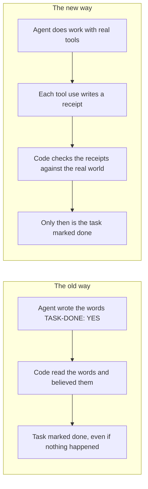
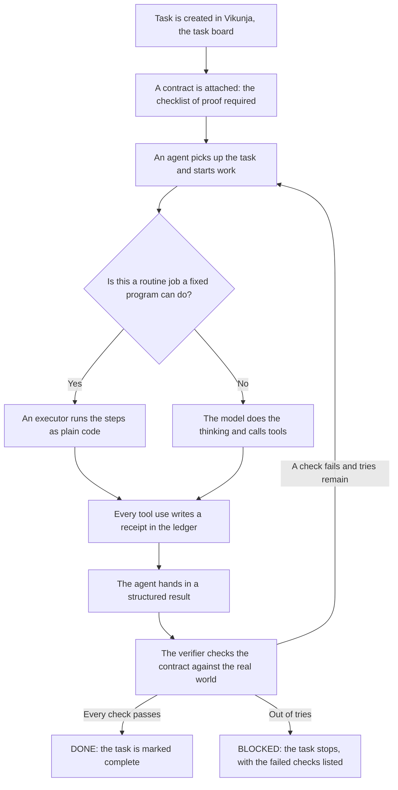
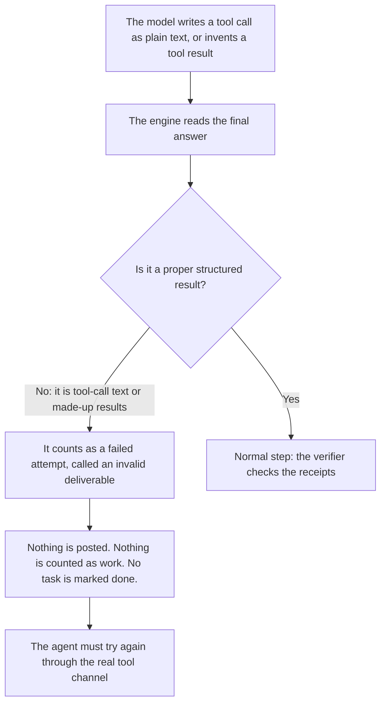

# How Tool Enforcement Works, in Plain Words

This page explains, in simple terms, how the MACF team of AI agents proves that work really happened.

The short version: an agent saying "I did it" counts for nothing now. The computer keeps its own written records, called receipts, every time a tool actually runs. A task can only be marked done when the computer checks those records against the real world and every check passes. The agent's words never decide anything.

If you only read one section, read "Why this exists." It tells the story that caused this system to be built.

---

## Why this exists

On October 12, 2026, the work engine ran for hours. The status reports said tasks were being worked on. When we pulled the actual records, we found the truth: the agents were not doing the work. They were writing about the work.

One agent's "deliverable" was a line of text that looked like a tool call, the kind of instruction that should have made the computer read a file. Nothing had run. No file had been read. Worse, some outputs included results the agent had simply made up, written in the same style as a real tool answer. It looked like progress. It was fiction.

The old system caused this. It worked like a teacher who grades homework by reading the student's note that says "homework done." The agent wrote words. Code read the words and guessed whether they sounded true. Guessing failed, quietly, for hours.

So we changed the rule at the root:

**The computer only believes records it wrote itself, at the moment the work happened.**

Everything below is that one rule, built out part by part.

---

## The big idea, before and after

Think of it like a store. In the old way, a worker could say "I sold ten shirts" and the manager wrote it in the book. In the new way, the register prints a receipt for every sale, and the manager counts receipts. The worker's memory is not the record. The receipts are the record.

---

## Words used on this page

Each word below is explained once, in plain terms, and then used the same way every time.

- **Tool.** A small program an agent can run to do one real thing, like check a web page, read a file, save a file, or post a message.
- **Receipt.** A short written record the computer makes at the moment a tool runs. It says which agent, which task, which tool, whether it worked, and what it produced. Like a store receipt: it is proof created by the machine, not a claim made later by a person.
- **Ledger.** The notebook where all receipts are kept, one line per event, in order. Nothing is erased from it.
- **Schema.** A form with fixed blanks. It lists exactly which fields are allowed and what kind of answer goes in each one. A form that asks for a web address in the blank labeled "url" is a schema.
- **Contract.** A checklist attached to a task before work starts. It says what proof is required before that task may count as done. It is part of the task itself, written in a strict format the computer can read exactly.
- **Postcondition.** One item on the contract checklist. It is a check that must be true after the work is finished, such as "the report file exists and is at least this big."
- **Executor.** A fixed program that does a routine job step by step, the same way every time, with no guessing. Like a vending machine: money in, the same motions, the item drops. It cannot hand over goods without the steps actually running.
- **Native tool calling.** The proper channel built into the model service for using tools. The model sends a neat, structured request through that channel, the computer runs the tool, and the answer comes back through the same channel. The opposite is writing about tools in plain chat text, which is just words.
- **Constrained decoding.** Shaping the model's answer while it is being written, so it can only produce text that fits the required form. Think of a stencil for painting letters: the paint can only land inside the lines.

---

## The life of one task

This is the whole system in one picture. A task is born, gets its contract, gets worked on, and then faces the verifier, which is the part that checks the proof. Only the verifier can say "done."

A few things to notice:

- The agent never appears in the "done" decision. The verifier decides, from receipts and live checks.
- A failed check is not a disaster. The agent is told exactly which check failed and what was found instead, in numbers and facts, not opinions. Then it tries again.
- A task gets a limited number of tries (three, unless its contract says otherwise). After that it stops and is marked blocked, with the reasons written down. It never quietly pretends to be finished.

---

## What each part does

### The receipts ledger

Every time any tool runs, one small record is written into a file called the receipts ledger. It is stored by the code that ran the tool, at the moment it ran, whether the tool worked or failed. Each receipt names the agent, the task, the tool, and the result. When a tool saves a file, the receipt also stores a fingerprint of the file, a long string of characters computed from its exact contents, plus its size. If anyone later changes even one letter in that file, the fingerprint no longer matches. Receipts are also written for two important things that happen outside tools: posting a message to Slack, and creating or updating a task on the board. Those count as work products too, so they get receipts as well.

### The checkpoint at the door

Before a tool is allowed to run, the agent's request is checked against that tool's schema, the form with fixed blanks. If the agent fills in the wrong blank, leaves a required blank empty, or adds a blank that does not exist, the tool does not run at all. Instead, the agent gets back a neat, machine-readable note that says exactly what was expected, what arrived, what is missing, and what does not belong. This sounds small, and it fixes a real accident: an agent once asked the page checker to check a blank called "arg" instead of "url," and the old system let the call through to fail in a confusing way. Now that mistake is caught at the door, in code, every time, on every route. If the agent repeats the exact same wrong request, the system stops the attempt early instead of wasting rounds.

### Native tool calling

Models get to tools through the proper built-in channel of the model service, described in the word list above. The tool list is sent to the model as schemas, the model answers with structured requests, the computer runs them, and structured answers go back. There is still an old-style backup path where the model writes tool requests as plain text, for the rare route that has no proper channel. That backup is never silent: every time it is used, the result is stamped with a flag that says so, a warning is logged, and the fact is recorded. We always know which path a piece of work took.

### Constrained decoding, in plain terms

On model services that support it, the answer itself is shaped while it is being written, so it comes out in the required form rather than a form the model felt like using. That is constrained decoding. One honest note: the strongest version of this runs inside special model servers, and we do not run one of those ourselves, because our models come from hosted services. So our guarantee does not rest on that layer. It rests on the checkpoint at the door, which no request can skip, and on checking every result again in our own code after it arrives. The practical protection is the same on our routes: a call that breaks the form never runs.

### Task contracts

A contract is the checklist attached to a task, written in a strict block inside the task's own description on the board. It names the tools that must succeed, the postconditions that must be true at the end, the shape the final result must take, and how many tries are allowed. Most contracts are stamped from ready-made templates, so nobody has to write the strict format by hand: there are templates for checking a set of web pages, writing a report file, filing new tasks, posting a prepared message, and a few more. A task with no contract is not trusted by the engine at all, which leads to the next part.

### The verifier, and the only door to "done"

When an agent says its work is ready, a part of the system called the completion verifier checks the contract, item by item, against the real world. "The report exists" is checked by looking at the actual file and comparing its fingerprint with the receipt. "The page is up" is checked by visiting the page, live, and recording the status code that comes back. "The ticket exists" is checked by asking the task board directly. "Enough checks ran" is checked by counting receipts in the ledger. Only when every single item passes does the verifier mark the task done on the board. That marking happens in exactly one place in the entire codebase, inside the verifier, so there is no side door. If any item fails, the agent gets the list of failures as plain data, for example "page check: expected status 200, found 404," and goes back to work with facts instead of a pep talk.

### Structured results

For a task with a contract, the agent's final answer must arrive in a fixed shape: a short summary, links to the things it produced, and its findings, all in named fields. If the answer does not fit the shape, it is not debated. It counts as a failed try, the same as a tool error, and nothing is posted or passed along. This is the rule that turns the October 12 problem into a non-event: text that merely looks like work cannot be handed in as work, because the hand-in slot only accepts the fixed shape, and even a perfectly shaped answer still has to pass the verifier.

### Deterministic executors

Some jobs are pure routine: check these pages, read these files and write the report, file these tickets, post this message. For those, a fixed program does the job. The executor runs each step by calling the same tools the agents use, so every step writes a receipt and passes the checkpoint, exactly as if an agent had done it. The model is invited in at most once, through a single narrow doorway, and only for the part that is genuinely writing, such as summarizing what changed on the pages. Its input is the data the code already collected, and its answer must fit a schema before it is used. A summary can be good or bad, but it can never decide whether the steps ran. They ran, and the receipts prove it either way. There are four executors today: url-sweep (checks a list of web pages), file-report (reads inputs and writes a report file), ticket-filer (creates tasks on the board from a list), and slack-poster (posts a prepared message).

### Demos backed by receipts

When the team shows Jesse a finished piece of work, that is called a demo. The old way decided "this looks like a demo" by reading the message and hunting for a link-shaped string. The new way is simpler: a demo exists only if the ledger holds a receipt for a real product of that task, such as a saved file, a posted message, or a created ticket. At the moment the demo is passed along, the product is checked again, live. If the file was deleted, or its fingerprint changed, the demo is not passed along, and the stale receipt is noted. Every demo line that reaches Jesse names the receipt it rests on, so it can always be traced back to the record.

### The auditor, now a scorekeeper

There is an older watchdog that used to read agent messages and guess at problems from the wording. Its guessing parts have been removed. It now simply reads the receipts ledger and reports counts: how many tool calls each agent made, how many failed, and of what kind. It also still performs two small real-world repairs it was already good at, like fixing a file permission so a tool can run. It observes and reports. It no longer decides anything about whether work counts.

---

## What happens when a model tries to fake a tool call

It still happens. Models sometimes write a tool call as plain text, or even invent the answer the tool would have given. Here is what that runs into now:

The key point: faking is no longer a scandal that a person has to catch. It is just a failed try, handled by the same machinery as any other failure. The fake text cannot be posted, cannot be passed to Jesse, and cannot move a task one inch toward done, because "done" is decided from receipts, and a fake produces no receipts.

---

## What got removed

To make room for all this, the old word-reading machinery was deleted, not just turned off:

- The rule that an agent ends its report with the words "TASK-DONE: YES" and the code believes it. Gone. There is no longer any way for an agent to declare its own task done.
- The evidence gate that scanned an agent's report for link-shaped and number-shaped text and called that proof. Gone. Proof is receipts and live checks now.
- The demo filter that approved anything containing a label, a link shape, and a task number shape. Gone, replaced by receipt-backed demos.
- The watchdog's text detectors that hunted for phrases like "Let me check" and for tool syntax in final answers. Gone. A missed tool is now visible as a missing receipt, which is a fact, not a guess.
- The cleanup code that scrubbed strange model symbols out of reports before posting them. Gone with the old path, because unshaped text is no longer accepted as a deliverable in the first place.

And one hard rule that came with the cleanup: a task with no contract cannot be completed by the engine at all. It waits until a contract is attached. The system would rather stop than guess.

---

## Honest limits

Plain talk about what this system does not do:

- It proves that work happened and that the required proof exists. It does not make the work brilliant. A report can pass every check and still be a mediocre report. Judgment about quality still belongs to people and reviewers.
- It cannot force a model to be clever. It can only refuse to count pretending as working, and say exactly which check failed.
- Contracts only exist where someone attached one. Rolling contracts onto older tasks is ongoing work, and until a task has one, the engine will not complete it.
- Checks against the live world can fail for passing reasons, like a network hiccup during a page check. The verifier records what it actually observed each time, so a blocked task shows whether it failed on substance or on a bad moment, and checks are retried once before being believed.

---

## Where this lives in the code

For anyone who wants to look under the hood:

- `slack-agents/engine/receipts.js`: the receipts ledger: writing receipts, reading them back, and the summary counts.
- `slack-agents/utils/agentTools.js`: the single doorway every tool call passes through, including the schema checkpoint and receipt writing.
- `slack-agents/utils/anthropic.js`: the conversation loop with the model: native tool calling, the flagged text backup path, and rejection of tool-call text as a final answer.
- `slack-agents/engine/taskContract.js`: contracts: reading them from task descriptions and the ready-made templates.
- `slack-agents/engine/completion.js`: the verifier: the checklist checks and the one and only place a task is marked done.
- `slack-agents/engine/workEngine.js`: the task lifecycle: the stages a task moves through, the try counter, and the blocked state.
- `slack-agents/engine/executors/`: the four fixed programs: url-sweep, file-report, ticket-filer, slack-poster.
- `slack-agents/engine/demoRelay.js` and `slack-agents/engine/sprintDemo.js`: receipt-backed demos.
- `slack-agents/engine/deliverableSchemas.js`: the fixed shapes that final answers must fit.
- The full technical design, with test plans and decision records, is in `docs/code-enforced-tool-use-design.md`.

---

## The one-sentence version

Agents propose, tools act, receipts remember, and code decides: that is the whole system.
